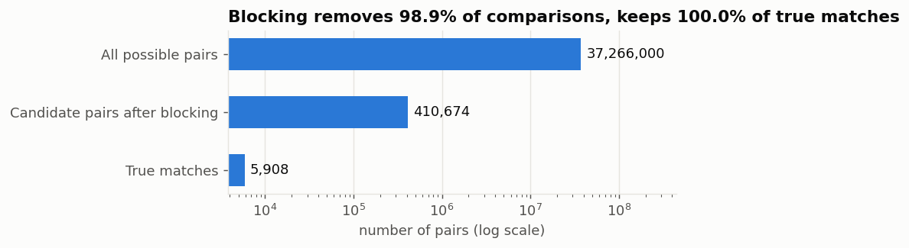
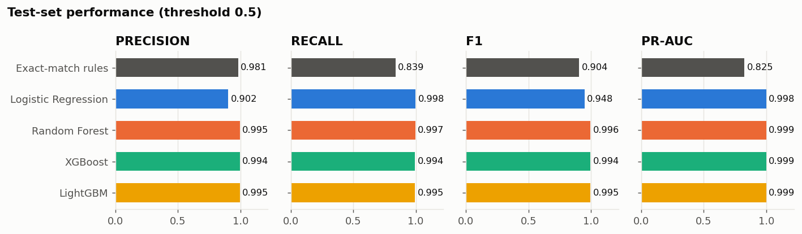
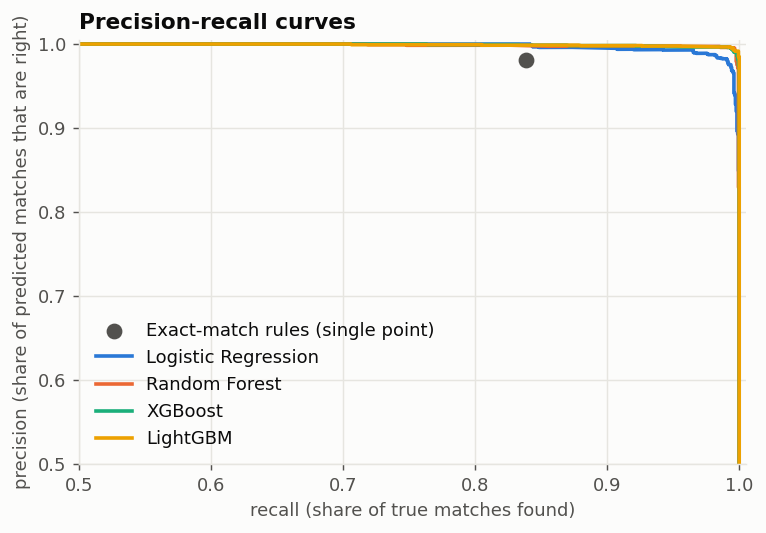
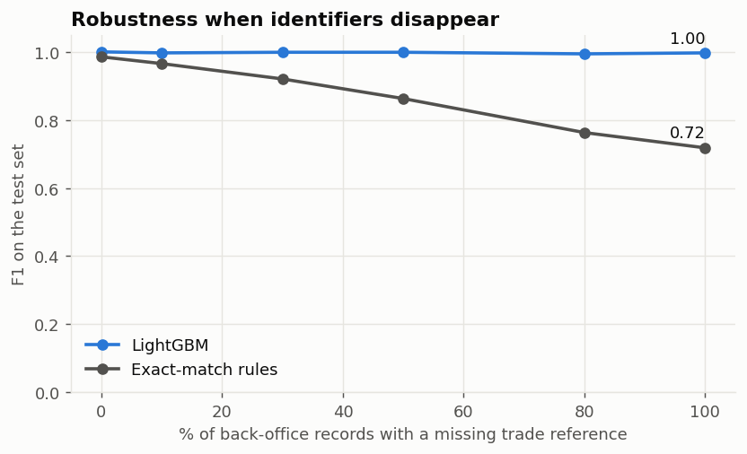
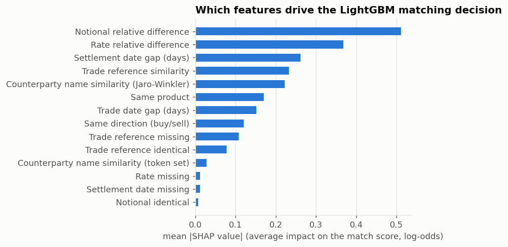

# Financial Transaction Matching & Entity Resolution Engine

Decides whether two records held in two different systems describe **the same underlying trade**, even when the trade reference is missing, the notional differs slightly, the dates are shifted or the counterparty name is spelled differently.

| | System A (front office) | System B (back office) |
|---|---|---|
| Trade ref | `TRD-104211` | *missing* |
| Instrument | EUR/USD spot | EUR/USD spot |
| Notional | 1,000,000 | 1,000,500 |
| Trade date | 2025-02-03 | 2025-02-03 |
| Counterparty | `BNP PARIBAS` | `Bnp Paribas SA` |

An exact-match rule rejects this pair. The model scores it as a match and shows why.

## Pipeline

```
 System A ─┐                                                   ┌─ match probability
           ├─► Blocking ─► Pairwise features ─► Classifier ─►──┼─ top-K candidates
 System B ─┘   (cheap rules   (14 similarity      (LightGBM)   └─ SHAP explanation
               cut 99% of      features)
               the pairs)
```

1. **Data** (`tmatch/generate.py`): synthetic FX trades (spot, forward, swap) booked in two systems. System B is corrupted with missing references (30%), re-formatted or mistyped references, notional noise, ±1 day date shifts, counterparty name variants, missing fields, duplicates, and unmatched records on both sides.
2. **Blocking** (`tmatch/blocking.py`): two passes: same currency pair with trade dates within 2 days, or identical normalised reference.
3. **Features** (`tmatch/features.py`): 14 pairwise features: reference equality and similarity, relative notional difference, date gaps, relative rate difference, Jaro-Winkler and token-set name similarity, direction and product agreement, missing-value indicators.
4. **Models** (`tmatch/models.py`): exact-match rules (baseline), Logistic Regression, Random Forest, XGBoost, LightGBM.
5. **Evaluation** (`tmatch/evaluate.py`): temporal split (train on the first 70% of days, test on the rest; pairs straddling the cut-off are dropped so no trade appears on both sides).
6. **Explainability**: TreeSHAP contributions per pair, shown in the dashboard and returned by the API.

## Results

All numbers come from `python -m tmatch.pipeline` (seed 42) and are stored in `results/metrics.json`.

**Blocking.** 6,000 × 6,211 records = 37.3M possible pairs → 410,674 candidates (98.9% reduction) with 100% of the 5,908 true matches kept. Only 1.4% of candidate pairs are matches, so the task is heavily imbalanced.



**Model comparison** on 119,085 held-out pairs (1,753 matches):

| Model | Precision | Recall | F1 | PR-AUC | False-positive rate | Recall@1 |
|---|---|---|---|---|---|---|
| Exact-match rules | 0.981 | 0.839 | 0.904 | 0.825 | 0.02% | 0.835 |
| Logistic Regression | 0.902 | 0.998 | 0.948 | 0.998 | 0.16% | 0.997 |
| Random Forest | 0.995 | 0.997 | 0.996 | 0.999 | 0.01% | 0.998 |
| XGBoost | 0.994 | 0.994 | 0.994 | 0.999 | 0.01% | 0.998 |
| LightGBM | 0.995 | 0.995 | 0.995 | 0.999 | 0.01% | 0.998 |




**Robustness to missing identifiers.** Data regenerated and the model retrained at each rate (3,000 trades):

| Missing references | 0% | 10% | 30% | 50% | 80% | 100% |
|---|---|---|---|---|---|---|
| LightGBM F1 | 1.000 | 0.997 | 0.999 | 0.999 | 0.994 | 0.997 |
| Exact-match rules F1 | 0.985 | 0.965 | 0.920 | 0.863 | 0.763 | 0.718 |



**What the model relies on** (mean |SHAP|): notional difference, rate difference, settlement-date gap, reference similarity, counterparty name similarity.



## Limitations

- **The data is synthetic.** Scores near 1.0 show the pipeline works on the noise I simulated; they say nothing about performance on real trade data, where noise is messier and labels are scarce.
- The model stays strong without references because rate, notional, settlement date and counterparty together almost identify a trade here. Real books with many identical trades (same counterparty, size and rate) would be harder.
- Blocking assumes the currency pair is always right and dates never differ by more than 2 days.
- Each pair is scored independently; there is no one-to-one assignment step and no handling of splits or partial settlements (see the companion project on trade lifecycle graphs).
- Not implemented: a Siamese network or other learned text embeddings.

## Run it

```bash
pip install -r requirements.txt
python -m tmatch.pipeline            # reproduces results/ (about 2 minutes)
python -m pytest -q                  # 8 tests
streamlit run app/dashboard.py       # analyst dashboard
uvicorn api.main:app --reload        # API, docs at http://127.0.0.1:8000/docs
```

The dashboard lets you pick a back-office record, see its ranked candidate trades with probabilities, compare the two records side by side and read the per-feature explanation. You can upload your own two CSV files with the columns of `data/sample_system_a.csv`.

## Layout

```
tmatch/      generate, blocking, features, models, evaluate, pipeline, service
app/         Streamlit dashboard
api/         FastAPI endpoint (/match)
tests/       pytest suite
results/     metrics.json and figures produced by the pipeline
data/        200-row samples of each system
```
